# REVIEW: fable-overnight

Everything here is on the branch `fable-overnight`. Nothing was pushed to `main`.

- Compare on GitHub: https://github.com/danielm-ho/portfolio/compare/main...fable-overnight
- Preview locally: `git fetch && git checkout fable-overnight && python3 -m http.server`, then open http://localhost:8000
- Before merging, delete `REVIEW.md` and the `review/` folder. They exist only for this review.

The list of copy I wrote is in the chat, as you asked, not here.

## What changed, one commit per idea

Undo any single idea with `git revert <commit>`. The paper theme is last so it
reverts cleanly.

| # | Idea | Commit | What changed |
|---|------|--------|--------------|
| 1 | Fix what's wrong (idea 6) | `6afb1cb` | Closed mobile menu no longer takes keyboard focus on desktop. LivePGH status says finished and handed off. Zab typo fixed. Music summary no longer contradicts the body. Em-dashes removed from rendered copy, titles and aria-labels. |
| 2 | Strip decoration (idea 7) | `e3c91a3` | Custom cursor, letter reveal, rotating roles, scroll hint, 01/02 numbering, glow, grain and magnetic buttons removed. About 200 lines of JS and 320 of CSS gone. |
| 3 | Work before About (idea 3) | `7d3b4b8` | Selected Work sits directly under the hero. On a 390px phone the first project moved from 3,590px down to about 1,300px. |
| 4 | Hero (V1 + idea 2) | `f431a2a` | Name, your statement, the Pamoza reason, and a line map of Pittsburgh's 90 neighborhoods with four LivePGH matches filled in. Proof strip cut to three figures. |
| 5 | LivePGH feature (V2) | `7f7bc35` | Full-width block with a browser-framed screenshot and a pull statement. New `featured` and `pull` fields in content.js. |
| 6 | Music band (V3 + idea 4) | `6404fa1` | Rose Ball photo edge to edge, "Watch the reel" opens the Drive video in a viewer, Music is in the nav. The music page shows the reel's own thumbnail. |
| 7 | Screenshots (V4) | `2460fb9` | Browser and phone frames, tap to enlarge, thumbnails no longer greyed out. `embedImage(src, alt)` replaces raw `` HTML in content.js. |
| 8 | Case-study layout (V5) | `548e690` | Lead image, then the writing, then the other screenshots. Decision set as a pull quote. Numbered callouts on the LivePGH image. Blocks are optional and headings can be renamed with `labels`. |
| 9 | Decisions (idea 1) | `cd30ecd` | Zab and LivePGH have decision blocks. Filler card figures removed. DRAFTED warnings replaced with a status of what you have confirmed. |
| 10 | Links (idea 9) | `b7d9643` | SWE Life links to the 15-112 Spring 2026 gallery and its repo. Zab links to its repo. |
| 11 | Slim Experience (idea 10) | `ff2c799` | One or two sentences per role, "Case study" links, Charpie linked. |
| 12 | Coursework list (idea 12) | `69cb6c8` | MonoMuse and Titanic are rows under the SWE Life card. New `compact` field. |
| 13 | Motion (V6) | `0bf4c31` | A card's picture grows into the project page's lead image and back. Scroll fade-ins removed. |
| 14 | Type and spacing (V7) | `23bdf7f` | Nothing under 12.8px. Fewer hairlines. Commas instead of dots and slashes. |
| 15 | Link preview image (V8) | `eba9fce` | New `og-home.jpg` with name, statement and map, generated from `tools/og-home.html`. |
| 16 | Paper theme (V9) | `4c63f7a` | Light paper palette. Dark palette kept under `data-theme="dark"`. |
| | Map credit | `9f91f8c` | Footer credits the neighborhood boundary data (CC BY requires it). |

The homepage went from 12,891px to 10,789px tall on a phone, and from 9,376px to 7,915px on desktop.

## Before and after

| | Before | After |
|---|---|---|
| First screen, 1440 | 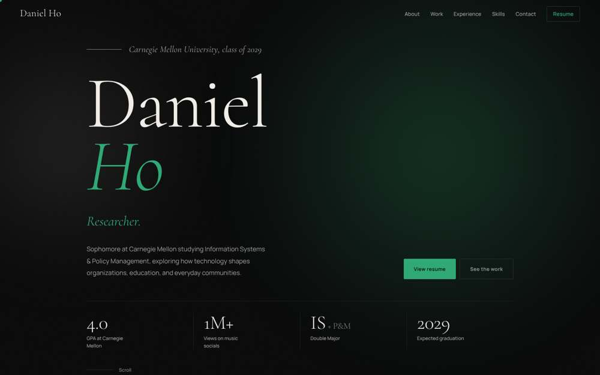 | 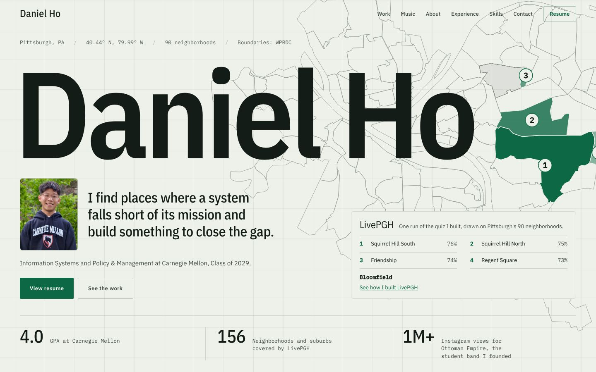 |
| First screen, 390 | 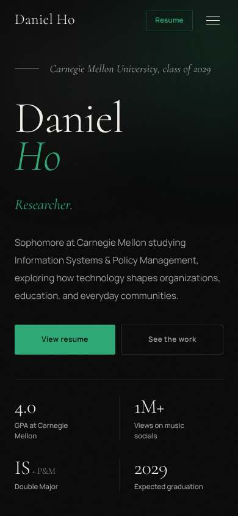 | 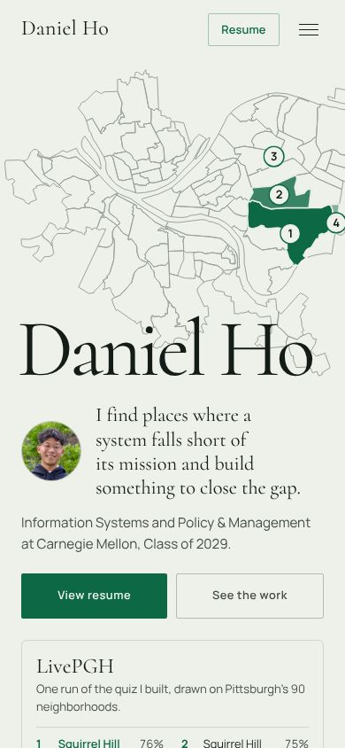 |
| Homepage, 1440 | 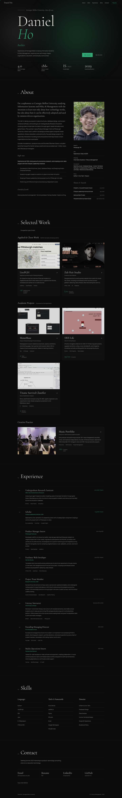 | 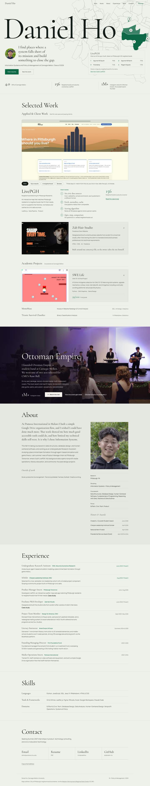 |
| Homepage, 390 |  | 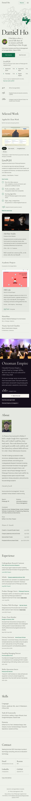 |
| LivePGH, 1440 | 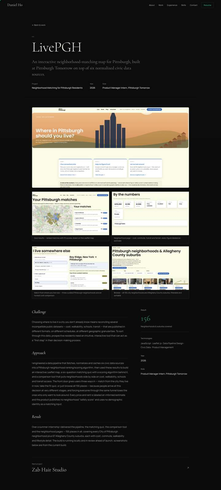 | 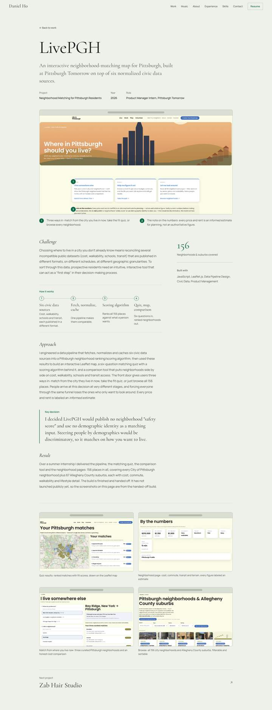 |
| LivePGH, 390 | 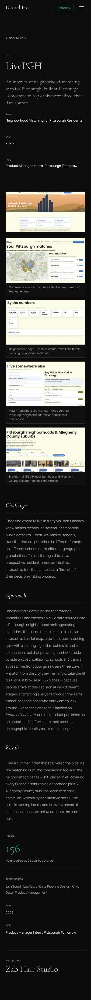 | 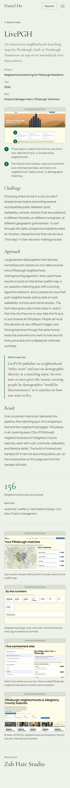 |
| Music page, 1440 | 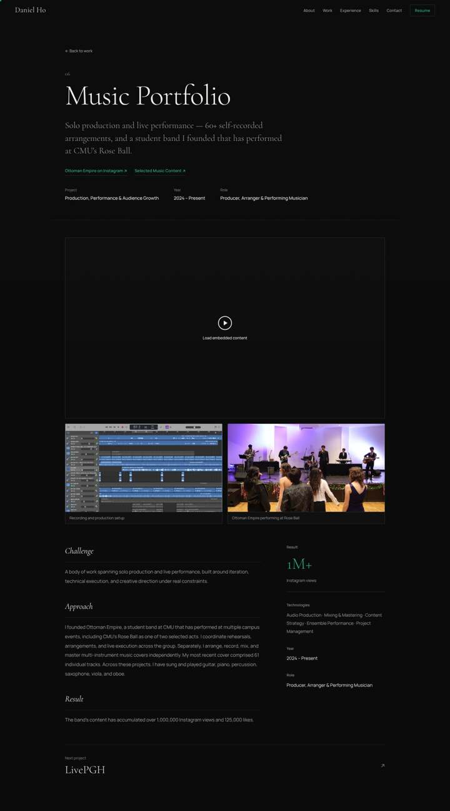 | 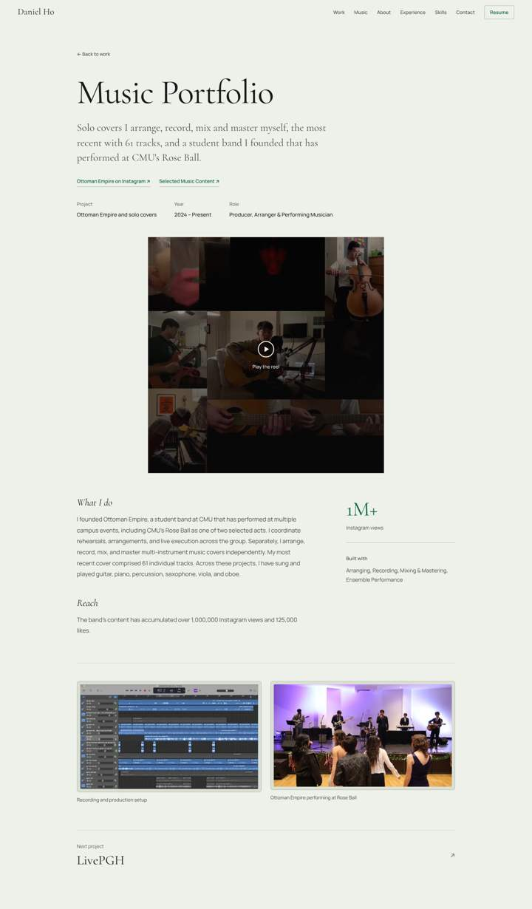 |
| Zab, 1440 | 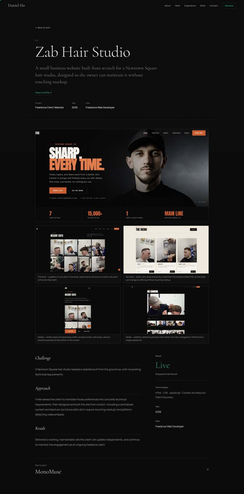 | 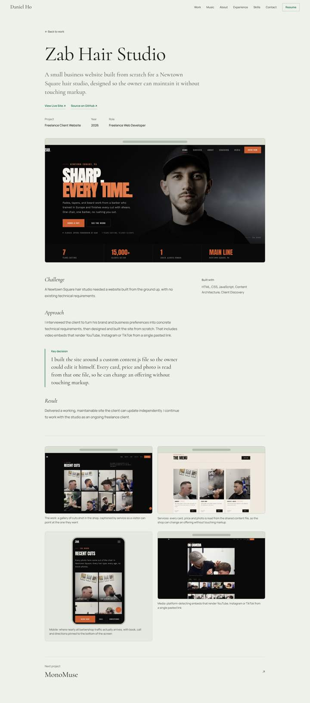 |

## TODOs, and exactly what each needs from you

In `static/content.js`, search for `TODO(Daniel)`. Each is a comment at the spot where the answer goes.

**Decisions (idea 1, unfinished)**

1. **LivePGH.** Was "no safety score, no demographic matching" your call? If yes: one sentence on what leaving them out cost you, then delete the `labels: { decision: ... }` line so the block is headed "Key decision".
2. **Zab.** One sentence: what did the content.js approach cost you, or what did you choose it over?
3. **SWE Life.** What did you cut, or choose the harder path on? Two or three sentences in a `decision:` field.
4. **Titanic.** Which model did you land on and what did you give up? The Result block also says nothing about what you found.
5. **MonoMuse.** Confirm the course, what the funnel analysis concluded, and what the memo recommended. That page's copy is still unverified.
6. **Music.** Optional: one decision about how the band works.
7. **Anything that went wrong or surprised you**, on any project. None of the pages has one yet.

**Ideas not started, waiting on files**

8. **LivePGH walkthrough video (idea 5).** A 60 to 90 second screen recording (mp4, or an unlisted YouTube link) and Pittsburgh Tomorrow's OK to publish it.
9. **LivePGH process artifacts (idea 11).** The 30-item QA audit with what failed and what you fixed, the names of the six data sources, and the scoring weights.
10. **Study Lab case study (idea 8).** The repo back up (or the decision not to link one), one lab page you are fine publishing that does not reproduce course material, and your account of what it does and what you changed.
11. **Design for America case study (idea 13).** Photos of the critique cards and yearbook template, and which parts were yours.

**Small ones**

12. **LivePGH launch.** When it goes public, add `{ label: 'Live site', url: '...' }` to its `links` in content.js and edit the last two sentences of its `result`.
13. **Rose Ball.** A public page to link to, if one exists.
14. **Instagram reel.** One reel URL, if you want a second way to play the music.

## Copy options

Where your answers left room, the page has my best version. Here is a second one for each. Swap them in content.js.

**Hero description** (`CONTENT.hero.desc`)
- On the page: "Sophomore at Carnegie Mellon, studying Information Systems and Policy & Management. I chose IS after working with Pamoza International in Malawi, where I saw how much good accessible tools could do and how limited my technical skills still were."
- Option B, puts the ask first: "Sophomore at Carnegie Mellon, studying Information Systems and Policy & Management. Looking for Summer 2027 internships in product, technology consulting, and civic or education tech."

**About, first paragraph** (`CONTENT.about.bio[0]`)
- On the page: "At Pamoza International in Malawi I built a simple Google Drive organization flow, and I wished I could have done much more. That work showed me how much good accessible tools could do, and how limited my technical skills still were. It is why I chose Information Systems."
- Option B, your brief verbatim: "I chose Information Systems after doing nonprofit database work for Pamoza International in Malawi. That work showed me how much good accessible tools could do, and how limited my technical skills still were."

**LivePGH pull statement label** (`PROJECTS.livepgh.pull.label` and `labels.decision`)
- On the page: "What LivePGH won't do"
- Option B, if the call was yours: "A decision I made"

**Zab decision** (`PROJECTS['zab-hair-studio'].decision`)
- On the page: "I built the site around a custom content.js file so the owner could edit it himself. Every card, price and photo is read from that one file, so he can change an offering without touching markup."
- Option B, only your sentence: "I built a custom content.js page so he could edit it himself."

**Music band** (`CONTENT.music.lede`)
- On the page: "I founded Ottoman Empire, a student band at Carnegie Mellon. We were one of two acts selected for CMU's Rose Ball."
- Option B: "Ottoman Empire is the student band I founded at Carnegie Mellon. Its Instagram has passed a million views."

## Open questions

1. **LivePGH count.** The copy says 156 places: every city neighborhood plus 67 suburbs, which implies 89. Your landing-page screenshot says "all 90", and the hero map caption says 90 because the city's boundary file has 90. I left 156 as written. Which is right?
2. **1M+ views.** The hero and band section credit them to Ottoman Empire, as your brief does. The old card said "across both projects". Which is it?
3. **Pamoza.** Your brief calls it "nonprofit database work", your resume a "centralized media workflow", and last night "a simple Google Drive organization flow". The site now uses the last one. Make sure the resume and site tell the same story.
4. **SWE Life.** The site used to say "a feature on" the course website. I could verify that the gallery lists it, so it now says "listed in the project gallery". Change it back if the gallery is selective and "feature" is fair.
5. **Music summary.** It said "60+ self-recorded arrangements". The body says the latest cover had 61 tracks, so I matched the body. If you have also made 60+ arrangements, say so and I got this wrong.
6. **Paper theme.** Keep it, or revert `4c63f7a`? A middle option is to show the dark palette to visitors whose device is in dark mode; that is one CSS block.
7. **MonoMuse.** Its GitHub Pages build (danielm-ho.github.io/67250_techproject_phaseb) is unstyled HTML, so I did not link it. Your call.
8. **Experience lines.** You were going to pick the one fact per role. I picked. Check them.

## What I'm unsure about

- **The project transition** was checked in Chromium only, in both directions. Safari and Firefox should fall back to a normal page load, but I did not test them.
- **The reel.** I confirmed the Drive player loads in the viewer. I could not confirm it plays for every logged-out visitor, and it needs a second tap on Drive's own play button.
- **Real devices.** All screenshots are from an emulated 1440px desktop and 390px phone. Nothing was checked on an actual phone.
- **Render-blocking scripts.** The three scripts now block the first frame so the page never flashes empty. They are small and local, but if the site ever feels slower to appear, this is the line to look at in `index.html`.
- **Page weight.** You said performance can't get worse. By bytes it did, by about 110KB on the homepage (map file plus the band photo). I judged the map and the band worth it, but it is your rule, so check the line above.
- **The four matched neighborhoods** on the map are from one test run in your screenshot. If that run was not representative, change `CONTENT.hero.map.matches`.

## Checks run on the final state

- All seven pages plus the 404 at 1440px and 390px: no console errors, no failed requests, no horizontal overflow, no em-dashes in rendered text.
- Keyboard: Tab order on every page lands only on visible elements, each with a visible focus ring. The viewer opens with Enter, closes with Escape, and returns focus to the button.
- Phone menu opens, shows all links, closes on tap, and is inert while closed.
- `prefers-reduced-motion`: no animations run.
- Every visible image has alt text. No broken images.
- Contrast on paper: body ink 7.7:1, metadata 5.8:1, accent 5.9:1.
- No libraries added. Page weight went up, not down: HTML, CSS and JS together are 60KB gzipped, up from 45KB, and 12KB of that is the new map outline file. The homepage also now loads the Rose Ball photo (96KB, lazy-loaded) for the music band. The grain overlay, custom cursor and scroll observers are gone, so there is less work per frame.

## Spotted, not done (out of scope)

- The resume PDF is dated September and does not mention Ottoman Empire or Study Lab.
- Link preview images for the six project pages are still the old dark design.
- The music page is still titled "Music Portfolio".
- The Skills grid still lists "Google Workspace" and "Excel".
- `static/files/headshot.jpeg` (1MB) and several `.png` originals appear unused next to their `.webp` versions.
- Your local "mi website" folder is not a git repository, so it does not have this branch. Clone the repo or download the branch to see the changes on your computer.
